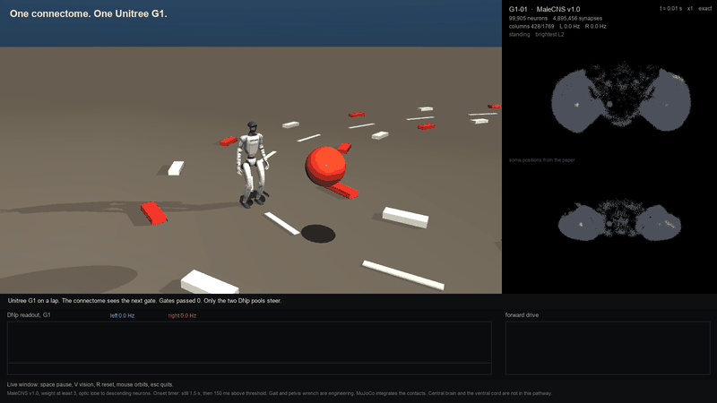

# Telotaxis

The released male fruit-fly central nervous system, closed loop, steering a Unitree G1 around a lap.

Telotaxis is the ethology term for directed movement toward a localized stimulus. One humanoid, one connectivity, its own neural state. A red gate is the only thing the eyes are given. When the runner reaches it, the gate moves to the next mark on the oval. The only motor command is two numbers: the left posterior descending pool and the right one.



## What is actually in the pathway

MaleCNS v1.0 has 165,122 traced neurons. This demo runs the visual path through them:

| | |
| --- | --- |
| Neurons | 99,905 traced |
| Signed synapses | 4,895,456, each of weight at least 3 |
| Lamina L1–L5 | 8,883 |
| Visual projection | 9,201 |
| Descending | 1,314, of which 320 are DNp |
| Retinotopic columns | 1,769 |

Left out, on purpose: central-brain intrinsic neurons, the ventral nerve cord, sensory neurons outside the optic lobe, and photoreceptors. Light enters at the lamina, the same cut Fly.exe uses, because photoreceptor signs in the release are not resolved. The point-neuron step is 5 ms on CPU. It is not the 100 µs step of a GPU spike engine, and it is not biological real time once several cars are running.

Signs follow the transmitter, not a guess about the edge. Acetylcholine is excitatory. GABA, glutamate, and histamine are inhibitory. Glutamate is inhibitory in the fly central nervous system, and lamina L1 is glutamatergic. Octopamine, serotonin, dopamine, and unclear cells are dropped.

Soma positions in the black panel are the paper's coordinates, rotated into lateral, anterior, and dorsal. Lamina cells with no soma sit on a hex shell at their eye. Nothing else is invented.

## The loop

Each 15 ms:

1. Bearing and angular size of every sphere, from the car's pose. No pixels, no raycast, no colour. A column takes the max of spatial falloff times loom, not the sum.
2. That drive is applied to the lamina columns of every car. Other cars are spheres of radius 0.20 m.
3. Three leaky-integrate-and-fire steps advance the 99,905 cells. Weights are shared. Membrane, adaptation, spikes, and noise are not.
4. The wheels receive the command computed on the previous interval. Positive left-minus-right rate is a left turn.
5. The new command is stored for the next interval.

Cars stand still for 1.5 s. After that, a pool mean of 8 Hz held for 150 ms latches forward drive. There is no stop state. A car blocked by a sphere keeps being told to go forward. Cars do not collide with each other. They do collide with the floor, the food, and the pillars.

On the Unitree G1 the two numbers become a walking speed and a yaw rate. MuJoCo integrates the joint torques and the foot contacts. A small wrench on the pelvis trims lean and heading. Nothing in the gait writes a joint velocity. The step pattern, that wrench, and the onset timer are engineering. The synapses are not. A car body is still there (`--body car`) for the earlier swarm.

## Run

```bash
pip install -r requirements.txt
python3 -m telotaxis live          # Unitree G1. space pause, V vision, R reset, arrows orbit
python3 -m telotaxis record --seconds 10 --fps 6 --out docs/media/g1.mp4
python3 -m telotaxis live --body car --cars 12
```

`--body` is `g1`, `car`, or `robot`. `--variant absent` keeps the gate and pins the encoder at baseline, so the humanoid does not start. The live window renders the MuJoCo scene each tick and refreshes the soma cloud a few times a second, which is what keeps the picture moving. Recording still renders a full frame offscreen.

A 10 s run, seed 1: the G1 starts walking after the 1.5 s onset, passes 3 gates, travels 6.3 m, and is still upright (pelvis height 0.75 m). With the stimulus removed it stays standing (4 s, displacement 3 mm). The recording is `docs/media/g1.mp4`.

The G1 mesh is the [MuJoCo Menagerie](https://github.com/google-deepmind/mujoco_menagerie) Unitree G1, BSD-3-Clause. See `assets/unitree_g1/LICENSE`.

## Rebuild the pathway

The public tables are about 1 GB and are not in this repo. Put these three files in `data/raw/` and run `python3 scripts/build_pathway.py`:

- `body-annotations-male-cns-v1.0-minconf-0.5.feather`
- `body-neurotransmitters-male-cns-v1.0.feather`
- `connectome-weights-male-cns-v1.0-minconf-0.5.feather`

Source: <https://storage.googleapis.com/flyem-male-cns/v1.0/connectome-data/flat-connectome/>

`data/pathway.npz` in the repo is that build. Its licence is CC-BY-4.0, not MIT. See NOTICE.

## Credit

Connectome: Berg et al., Cell, 2026. doi:[10.1016/j.cell.2026.08.015](https://doi.org/10.1016/j.cell.2026.08.015). [MaleCNS v1.0](https://male-cns.janelia.org/download/), CC-BY-4.0.

Loop design: [Fly.exe](https://github.com/Ibtisam-Mohammad/Fly.exe). This repo reimplements the published contract and does not include that source.

Code: MIT. Jaskirat Singh.
