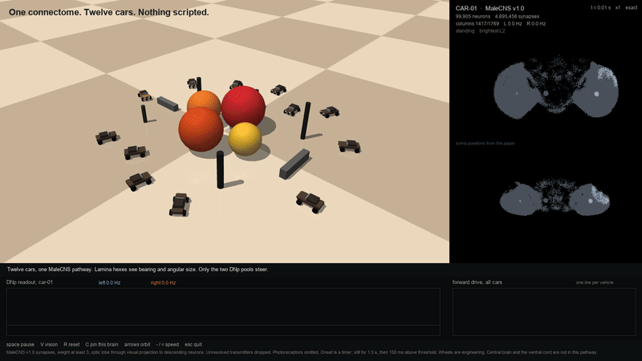

# Telotaxis

The released male fruit-fly central nervous system, closed loop, steering cars toward what it sees.

Telotaxis is the ethology term for directed movement toward a localized stimulus. Twelve cars share one connectivity and keep twelve independent neural states. Nothing in the arena is scripted. Food is a red, orange, or yellow sphere. Pillars and slabs are obstacles. The only motor command is two numbers: the left posterior descending pool and the right one.



## What is actually in the pathway

MaleCNS v1.0 has 165,122 traced neurons. This demo runs the visual path through them:

| | |
| --- | --- |
| Neurons | 99,905 traced |
| Signed synapses | 4,895,456, each of weight at least 3 |
| Lamina L1–L5 | 8,883 |
| Visual projection | 9,201 |
| Descending | 1,314, of which 320 are DNp |
| Retinotopic columns | 1,769 |

Left out, on purpose: central-brain intrinsic neurons, the ventral nerve cord, sensory neurons outside the optic lobe, and photoreceptors. Light enters at the lamina, the same cut Fly.exe uses, because photoreceptor signs in the release are not resolved. The point-neuron step is 5 ms on CPU. It is not the 100 µs step of a GPU spike engine, and it is not biological real time once several cars are running.

Signs follow the transmitter, not a guess about the edge. Acetylcholine is excitatory. GABA, glutamate, and histamine are inhibitory. Glutamate is inhibitory in the fly central nervous system, and lamina L1 is glutamatergic. Octopamine, serotonin, dopamine, and unclear cells are dropped.

Soma positions in the black panel are the paper's coordinates, rotated into lateral, anterior, and dorsal. Lamina cells with no soma sit on a hex shell at their eye. Nothing else is invented.

## The loop

Each 15 ms:

1. Bearing and angular size of every sphere, from the car's pose. No pixels, no raycast, no colour. A column takes the max of spatial falloff times loom, not the sum.
2. That drive is applied to the lamina columns of every car. Other cars are spheres of radius 0.20 m.
3. Three leaky-integrate-and-fire steps advance the 99,905 cells. Weights are shared. Membrane, adaptation, spikes, and noise are not.
4. The wheels receive the command computed on the previous interval. Positive left-minus-right rate is a left turn.
5. The new command is stored for the next interval.

Cars stand still for 1.5 s. After that, a pool mean of 8 Hz held for 150 ms latches forward drive. There is no stop state. A car blocked by a sphere keeps being told to go forward. Cars do not collide with each other. They do collide with the floor, the food, and the pillars.

The differential drive and the onset timer are engineering. The synapses are not.

## Run

```bash
pip install -r requirements.txt
python3 -m telotaxis live          # window. space pause, V vision, R reset, C pin, arrows orbit
python3 -m telotaxis run           # 12 cars, 12 s, then the stimulus-absent control
python3 -m telotaxis frame --at 4  # one still
python3 -m telotaxis record        # docs/media/telotaxis.mp4
```

`--cars` is 1 to 24, `--body robot` swaps the mesh, `--variant absent` keeps the objects and pins the encoder at baseline. On macOS the viewer sets `MUJOCO_GL=cgl`.

Twelve cars, seed 1, 6 s, on an Apple M2 Max: all 12 locomoting, all 12 closer to food (median closure +1.40 m), 8 of 12 ended against an object, displacement 0.86–1.78 m. The same scene with the stimulus removed does not move. The recording is `docs/media/telotaxis.mp4`.

## Rebuild the pathway

The public tables are about 1 GB and are not in this repo. Put these three files in `data/raw/` and run `python3 scripts/build_pathway.py`:

- `body-annotations-male-cns-v1.0-minconf-0.5.feather`
- `body-neurotransmitters-male-cns-v1.0.feather`
- `connectome-weights-male-cns-v1.0-minconf-0.5.feather`

Source: <https://storage.googleapis.com/flyem-male-cns/v1.0/connectome-data/flat-connectome/>

`data/pathway.npz` in the repo is that build. Its licence is CC-BY-4.0, not MIT. See NOTICE.

## Credit

Connectome: Berg et al., Cell, 2026. doi:[10.1016/j.cell.2026.08.015](https://doi.org/10.1016/j.cell.2026.08.015). [MaleCNS v1.0](https://male-cns.janelia.org/download/), CC-BY-4.0.

Loop design: [Fly.exe](https://github.com/Ibtisam-Mohammad/Fly.exe). This repo reimplements the published contract and does not include that source.

Code: MIT. Jaskirat Singh.
